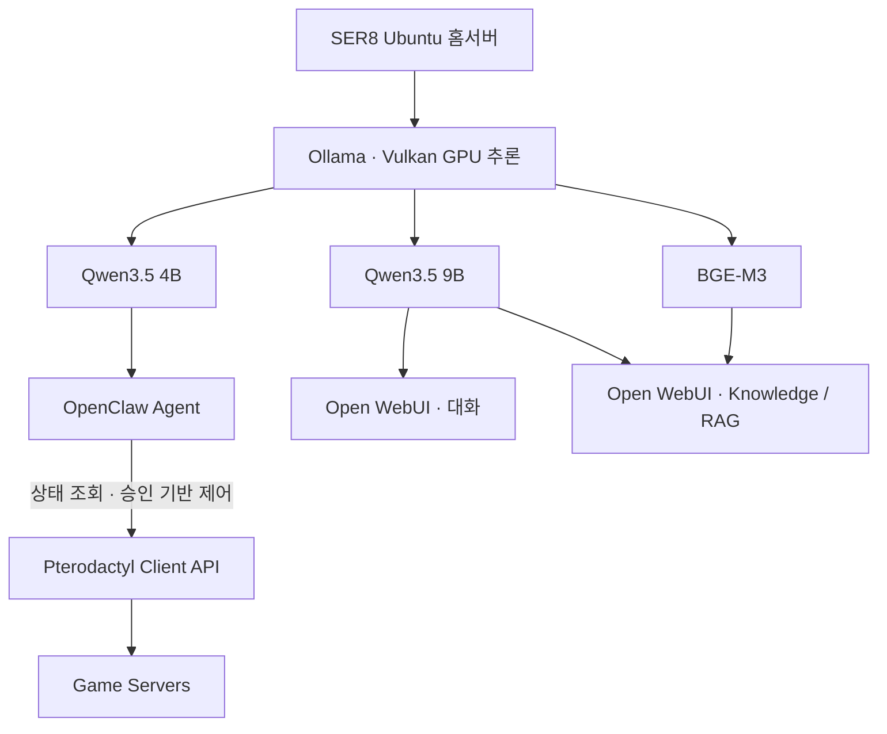

# SER8 로컬 LLM 서버

Minisforum SER8과 Ubuntu 홈서버에서 Ollama, Open WebUI, OpenClaw를 연결해 직접 운영하고 실험하는 로컬 AI 프로젝트입니다.

## 프로젝트 목적

보유 중인 홈서버에서 로컬 LLM이 어느 정도까지 실용적으로 동작하는지 확인하고, 대화·문서 검색·서버 관리에 활용하는 과정을 기록합니다. 설치 자체보다 제한된 하드웨어에서 발생한 문제를 진단하고 해결하는 데 초점을 둡니다.

## 서버 환경

| 항목 | 현재 환경 |
| --- | --- |
| 하드웨어 | Minisforum SER8 |
| CPU | AMD Ryzen 7 8745HS |
| 메모리 | 16GB |
| GPU | Radeon 780M 내장 그래픽 |
| 운영체제 | Ubuntu 24.04 LTS |
| 컨테이너 | Docker |
| 기존 서버 환경 | Pterodactyl Panel / Wings |

## 현재 구성

현재 실제로 동작을 확인한 구성입니다.

OpenClaw Gateway는 `127.0.0.1:18789`에만 바인딩하고, Windows PC에서 SSH 터널과 Gateway Token 인증을 사용해 접속합니다. 외부나 LAN에 Gateway 포트를 직접 노출하지 않는 구성을 의도적으로 유지하고 있습니다.

## 현재 구현 상태

### 완료

- [x] Ubuntu 호스트에 Ollama 설치 및 실행
- [x] Radeon 780M을 Vulkan 추론 장치로 활성화
- [x] `ollama ps`에서 모델의 `100% GPU` 실행 확인
- [x] Docker 기반 Open WebUI 구축 및 채팅 확인
- [x] BGE-M3를 이용한 Knowledge / RAG 구축 및 출처 확인
- [x] OpenClaw `2026.8.2` 설치 및 Gateway 구성
- [x] OpenClaw 기본 모델을 `ollama/qwen3.5:4b`로 설정
- [x] OpenClaw에서 Ubuntu 기본 상태 조회 확인
- [x] Pterodactyl 읽기 전용 상태 조회 도구 구현 및 자연어 호출 확인
- [x] Pterodactyl 서버 시작·종료·재시작 실동작 확인
- [x] 제어 후 서버 상태와 자원 사용량 재조회 확인
- [x] OpenClaw Context 및 Workspace 프롬프트 최적화
- [x] Exec 정책을 `allowlist`와 `on-miss` 승인 방식으로 변경

상태 조회는 허용된 읽기 전용 명령으로 실행하고, 시작·종료·재시작은 실행할 때마다 사용자가 `Allow once`로 승인합니다.

`자연어 요청 → Qwen3.5 4B → 전용 wrapper → 사용자 승인 → Pterodactyl Client API → 상태 재조회 → 한국어 결과` 흐름으로 동작합니다.

## 모델 역할

| 모델 | 역할 | 현재 설정 및 확인 결과 |
| --- | --- | --- |
| `qwen3.5:4b` | OpenClaw Agent, 서버 상태 조회·제어, Tool Calling | Context 8192, Thinking OFF, 100% GPU |
| `qwen3.5:9b` | Open WebUI 대화, 코딩, RAG 답변 생성 | Context 8192, Thinking OFF, 100% GPU |
| `bge-m3` | Open WebUI RAG 임베딩 | Ollama Embedding Model로 설정 |

초기 실험에 사용한 `qwen3:4b`, `qwen3:8b`, `qwen3:14b`는 비교를 마친 뒤 삭제했습니다. 현재 Ollama에는 위 세 모델만 유지하고 있습니다.

## 동작 확인 결과

- Open WebUI에서 `qwen3.5:9b`를 이용한 일반 채팅 확인
- Knowledge 문서에서 CPU·메인 LLM·벤치마크 정보 검색 확인
- 문서에 없는 SSD 모델 질문에는 모른다고 답하고 Source를 표시하는 것 확인
- `Home Server Knowledge`의 여러 문서를 함께 검색해 서버 구성을 답하는 것 확인
- OpenClaw에서 `qwen3.5:4b` 한국어 추론과 Ubuntu 명령 실행 확인
- “현재 어떤 게임 서버가 켜져 있는지 확인해줘”라는 요청으로 실제 Pterodactyl 상태 조회 확인
- 특정 서버 이름을 지정한 조회도 정확 일치 우선으로 동작하는 것 확인
- 자연어 요청으로 Pterodactyl 서버 시작·종료·재시작 확인
- 상태 변경 전 사용자 승인과 제어 후 RUNNING 상태·CPU·RAM·Disk 재조회 확인

## 주요 문제 해결 경험

- Ollama가 내장 GPU를 제외하던 문제를 로그로 추적하고 `OLLAMA_IGPU_ENABLE=1`로 해결
- Qwen3 14B의 Vulkan 메모리 부족을 확인하고 하드웨어에 맞게 모델 구성을 재선정
- 약 13K token까지 증가한 OpenClaw Context를 분석해 Tracked Prompt Estimate를 약 3,173 tokens로 축소
- Pterodactyl API 원본 응답의 민감정보 노출 가능성을 확인하고 필요한 상태만 출력하는 읽기 전용 도구로 분리
- 작은 모델이 API 명령을 안정적으로 만들지 못한 문제를 `ptero-control`과 단순한 start·stop·restart wrapper로 해결

자세한 원인과 해결 과정은 [구축 기록](docs/build-log.md)에 정리했습니다.

## 보안 설계

- OpenClaw Gateway는 loopback에만 바인딩하고 SSH 터널과 Gateway Token으로 접속
- Pterodactyl 인증 파일은 서버 로컬에 보관하고 권한을 `600`으로 제한
- API 원본 JSON 대신 필요한 상태만 반환하는 wrapper 사용
- 읽기 전용 조회는 allowlist로 제한하고 상태 변경은 매번 사용자 승인 필요

## 문서

- [구축 기록](docs/build-log.md) — 문제, 원인, 해결, 결과 중심의 구축 과정
- [벤치마크](docs/benchmark.md) — 실제 모델 측정값과 테스트 조건
- [로드맵](docs/roadmap.md) — 완료, 진행 중, 예정 작업

## AI 활용

개발 과정의 설계, 문제 해결 및 문서 정리에 ChatGPT를 보조 도구로 활용했습니다. 설치·설정·테스트와 동작 검증은 실제 SER8 서버 환경에서 직접 수행했습니다.
