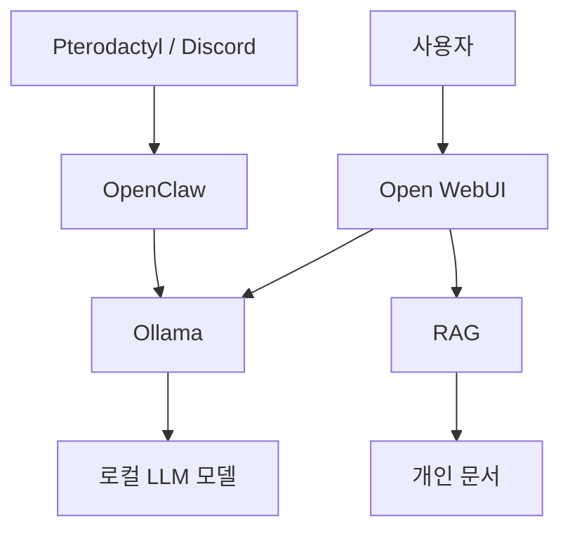

# 목표 아키텍처

## 전체 구성

## 구성 요소

| 구성 요소 | 역할 | 현재 상태 |
| --- | --- | --- |
| Ollama | 로컬 모델 실행 및 API 제공 | 미설치 |
| Open WebUI | 브라우저 기반 대화 인터페이스 | 미설치 |
| RAG | 개인 문서 검색과 답변 보강 | 미구현 |
| OpenClaw | 로컬 LLM 활용 자동화 실험 | 미연동 |
| Pterodactyl | 기존 게임 서버 관리 환경 | 운영 중 |
| Discord | 서버 상태 확인 및 향후 LLM 연동 | 기존 봇 운영 경험 있음 |

## 배포 방향

- 기존 Docker 및 Pterodactyl Wings 환경과 충돌하지 않도록 서비스별 구성을 분리한다.
- LLM 관련 서비스에는 메모리 및 CPU 제한을 적용할 수 있도록 설계한다.
- 외부 공개보다 내부 네트워크 사용을 우선한다.
- 실제 포트와 볼륨 경로는 구현 단계에서 확정하고 예제 환경 변수로 분리한다.

이 문서는 목표 구조이며, 벤치마크 결과에 따라 구성 요소나 실행 방식이 변경될 수 있다.

